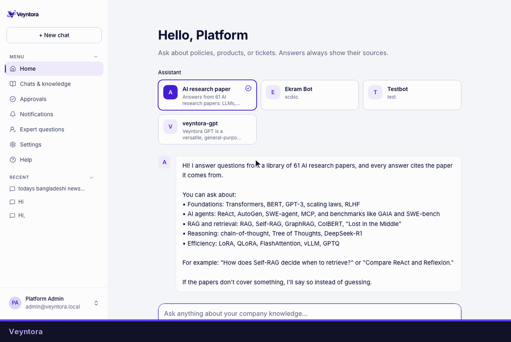
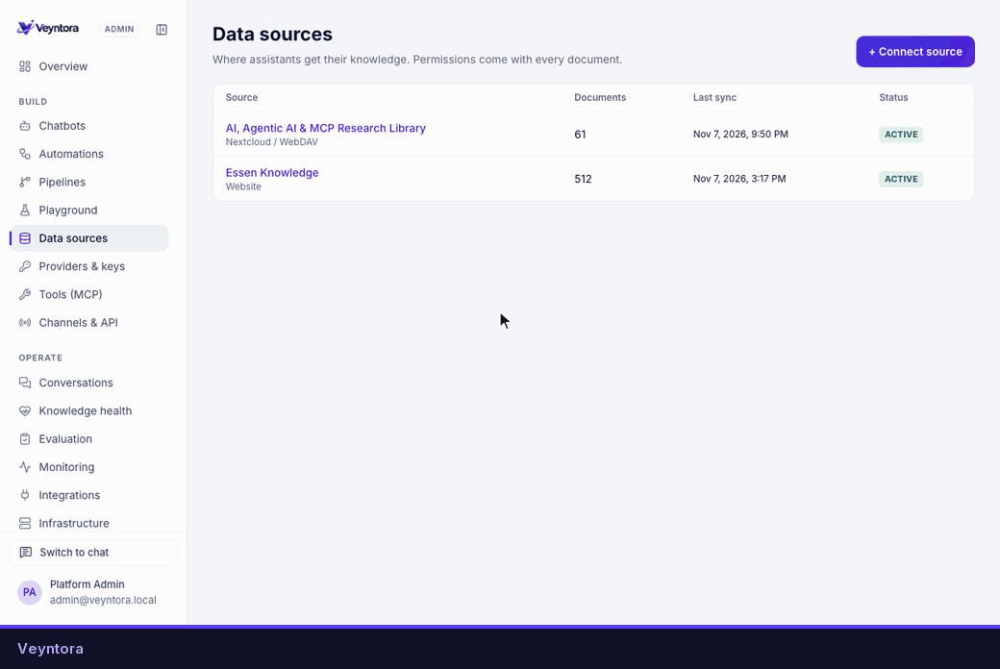
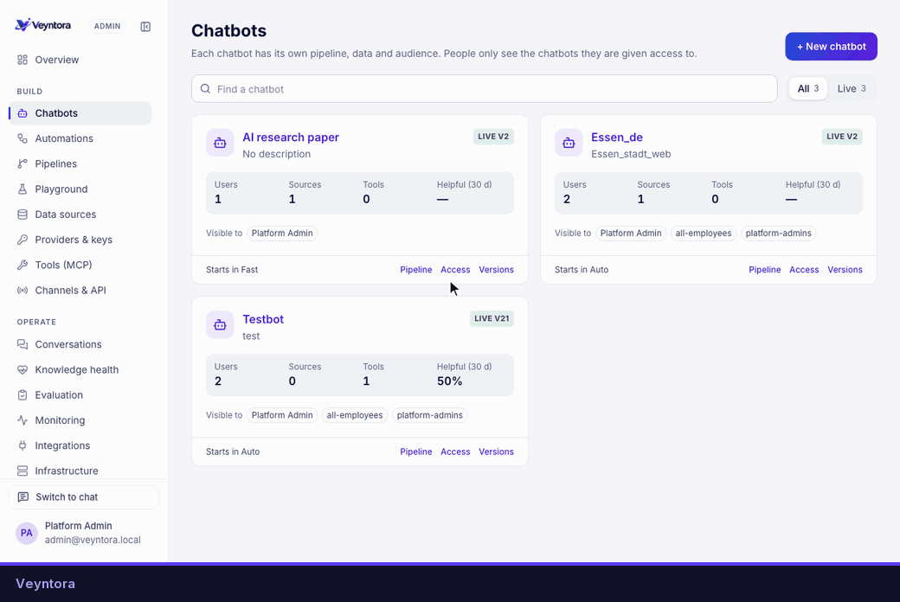
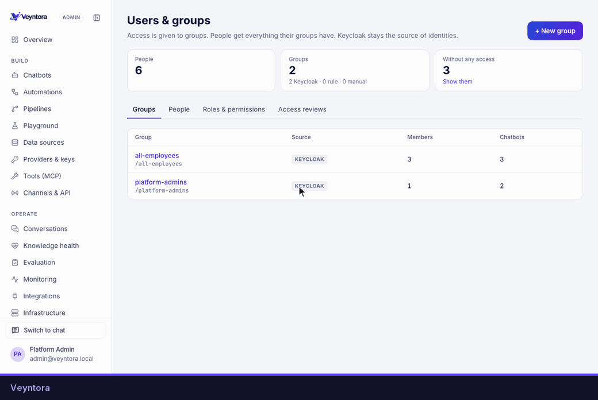
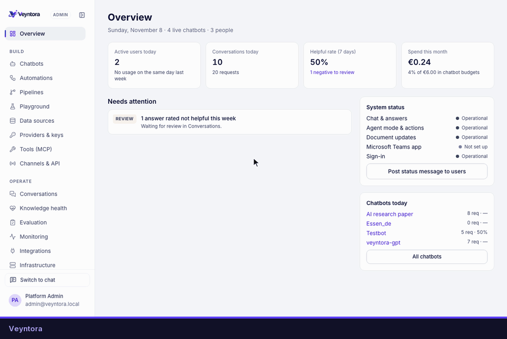

<p align="center"></p>

# Veyntora

[](https://github.com/shturag/veyntora/actions/workflows/ci.yml) [](LICENSE)

Open-source, self-hosted enterprise knowledge platform. Employees ask questions and get answers with sources they can check, or hand an agent a task that it carries out with their approval. Admins set up every step in a web console; nothing needs a code change.

## What it does

- **Answers with sources.** Fast mode searches the documents a person may read (hybrid search, reranking) and answers only from them, with numbered citations. If the sources don't support an answer, it says so instead of guessing.
- **Agents that ask first.** Agent mode plans, calls tools over MCP and waits for approval before anything that writes. Auto mode picks Fast or Agent for each question.
- **Many chatbots.** Each has its own knowledge, pipeline, models and audience. Versions are published, tested as canaries and rolled back from the console.
- **Your data sources.** SharePoint Online and Server, Confluence, file shares (SMB), document management (CMIS), Nextcloud/WebDAV, S3, Git (GitHub, GitLab), websites, ServiceNow knowledge, Jira, databases and uploads. Sources with their own permissions keep them; read-only MCP tools can be searched like documents.
- **Your infrastructure.** PostgreSQL, Valkey, S3, OpenBao, OpenFGA and Keycloak run where you choose and are set up in the browser. Models, embeddings, rerankers, vision models, vector store and parser are providers you connect: local (vLLM, Ollama, TEI, Qdrant, Docling) or external.
- **Governance.** Write-only secrets in OpenBao, permission-aware retrieval, PII masking, data rules for anything that leaves the network, a tamper-evident audit log, GDPR requests and access reviews.
- **Operations.** Evaluation with a publish gate, monitoring, knowledge health, usage and budgets, automations, and channels: web, Microsoft Teams, Slack, a web widget and a REST API.

## See it

**Ask a question.** Employees choose an assistant and get answers with numbered sources from documents they may read.



**Connect a data source.** Pick the system, fill in the connection, choose who may read and how often to sync.



**Create a chatbot.** Five steps: basics, knowledge, pipeline, access, then test and publish.



**Manage users and groups.** Access is given to groups; Keycloak stays the source of identities.



**The admin console.** Chatbots, pipelines, sources, providers, tools, monitoring, usage, governance and the audit log.



More in [docs/walkthroughs](docs/walkthroughs/README.md).

## Quick start

```bash
make env                          # .env with the config keys
make up                           # builds and starts Veyntora's own services
make setup-code                   # the code for the Setup page
open http://localhost:3000        # set up PostgreSQL, Valkey, S3, OpenBao, OpenFGA, Keycloak
```

No services of your own yet? `make env-ci && make up` starts throwaway copies too. Then add a language model, an embedding model, a vector store and a document parser under **Admin → Providers & keys**, connect a data source and create a chatbot.

**Installing for a team or company?** Follow [docs/installation.md](docs/installation.md): requirements, a trial on your computer, a server with Docker Compose, Kubernetes, first steps, updates and backups.

More in [docs/runbooks/local-dev.md](docs/runbooks/local-dev.md), [docs/runbooks/infrastructure.md](docs/runbooks/infrastructure.md) and [docs/runbooks/external-services.md](docs/runbooks/external-services.md).

## Layout

| Path | What |
|---|---|
| `apps/web` | Next.js app: front page, chat, admin console, setup |
| `services/api` | FastAPI: sign-in (BFF), OpenFGA checks, configuration, audit, the admin and chat APIs |
| `services/graphs` | LangGraph graphs served by Aegra: Fast answers, the assistant (Auto and Agent), Playground, automations |
| `services/workers` | Celery: syncing data sources, indexing, scans, schedules, retention |
| `services/channels` | Microsoft Teams and Slack |
| `services/sandbox` | Code interpreter, on an internal network without internet access |
| `packages/spec` | Pipeline and automation specs (Pydantic) and generated TS types |
| `packages/providers` | Provider interfaces, adapters, MCP client, secret scrubber |
| `packages/ui` | Design tokens and shared components |
| `evals` | Evaluation questions and corpus |
| `deploy/compose` | Local stack |
| `deploy/helm`, `deploy/argocd` | Kubernetes chart, values per environment, app-of-apps |
| `deploy/openfga` | Authorization model, tests, bootstrap mapping |
| `deploy/observability` | Prometheus scrape config and a Grafana dashboard for your own monitoring |
| `docs` | [Installation](docs/installation.md), [ADRs](docs/adr/README.md), [walkthroughs](docs/walkthroughs/README.md), runbooks, API reference, [user and admin flows](docs/user-flows.md), [use cases](docs/use-cases.md) |

## Development

`make help` lists the commands. `make lint`, `make test` and `make e2e` check the code; `make gen` regenerates the OpenAPI reference and the TypeScript types; `make ci` runs what CI runs before images are built.

## Contributing

Contributions are welcome: bug reports, fixes, connectors, providers and translations. Read [CONTRIBUTING.md](CONTRIBUTING.md) to get set up, and the [Code of Conduct](CODE_OF_CONDUCT.md). Report security problems privately as described in [SECURITY.md](SECURITY.md).

## License

Veyntora is licensed under the [Apache License 2.0](LICENSE). Third-party components keep their own licenses; see [NOTICE](NOTICE).
