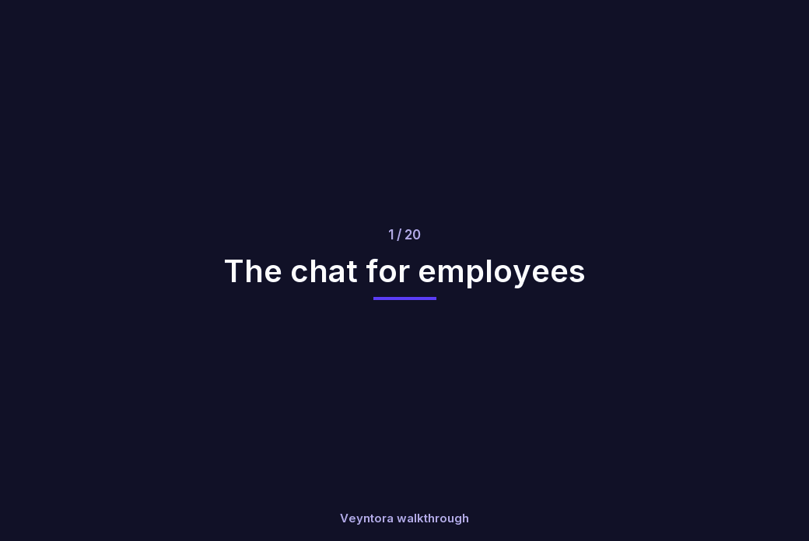

<div align="center">

<picture>
  <source media="(prefers-color-scheme: dark)" srcset="apps/web/public/brand/veyntora-logo-dark.png">
  
</picture>

**Answers your company can check. Agents that ask first. All on your own infrastructure.**

[](https://github.com/shturag/veyntora/actions/workflows/ci.yml)
[](LICENSE)


[Install](docs/installation.md) · [Walkthroughs](docs/walkthroughs/README.md) · [Architecture decisions](docs/decisions/README.md) · [Contributing](CONTRIBUTING.md) · [Security](SECURITY.md)

</div>

<p align="center"></p>

Open-source, self-hosted enterprise knowledge platform. Employees ask questions and get answers with sources they can check, or hand an agent a task that it carries out with their approval. Admins set up every step in a web console; nothing needs a code change.

## What it does

- **Answers with sources.** Fast mode searches the documents a person may read (hybrid search, reranking) and answers only from them, with numbered citations. If the sources don't support an answer, it says so instead of guessing.
- **Agents that ask first.** Agent mode plans, calls tools over MCP and waits for approval before anything that writes. Auto mode picks Fast or Agent for each question.
- **Many chatbots.** Each has its own knowledge, pipeline, models and audience. Versions are published, tested as canaries and rolled back from the console.
- **Your data sources.** SharePoint Online and Server, Confluence, file shares (SMB), document management (CMIS), Nextcloud/WebDAV, S3, Git (GitHub, GitLab), websites, ServiceNow knowledge, Jira, databases and uploads. Sources with their own permissions keep them; read-only MCP tools can be searched like documents.
- **Your infrastructure.** PostgreSQL, Valkey, S3, OpenBao, OpenFGA and Keycloak run where you choose and are set up in the browser. Models, embeddings, rerankers, vision models, vector store and parser are providers you connect: local (vLLM, Ollama, TEI, Qdrant or pgvector, Docling or Tika) or external.
- **Governance.** Write-only secrets in OpenBao, permission-aware retrieval, PII masking, data rules for anything that leaves the network, a tamper-evident audit log, GDPR requests and access reviews.
- **Operations.** Evaluation with a publish gate, monitoring, knowledge health, usage and budgets, automations, and channels: web, Microsoft Teams, Slack, a web widget and a REST API.

## Quick start

You need Docker with Compose and `make`.

```bash
git clone https://github.com/shturag/veyntora.git && cd veyntora
make env-ci && make up            # Veyntora plus throwaway PostgreSQL, Keycloak, OpenBao, …
open http://localhost:3000        # sign in as admin (the password is in .env)
```

Then add a language model, an embedding model, a vector store and a document parser under **Admin → Providers & keys**, connect a data source and create a chatbot.

**Ways to run it**

| Way | Commands | For |
|---|---|---|
| Try it | `make env-ci && make up` | Your computer; throwaway copies of every service |
| Your own services | `make env && make up`, then the Setup page (`make setup-code`) | A server; PostgreSQL, Valkey, S3, OpenBao, OpenFGA and Keycloak you run |
| Kubernetes | Helm chart and Argo CD apps in `deploy/` | Clusters; see [installation](docs/installation.md#c-kubernetes) |

**Optional services**

| Service | Start | Adds |
|---|---|---|
| Docling | your own docling-serve | Layout, tables and OCR for PDFs and Office files |
| pgvector | the `vector` extension in a PostgreSQL you run | The vector store in PostgreSQL instead of Qdrant |
| Apache Tika | `docker run -p 9998:9998 apache/tika:4.2.0-full` | Fast text from almost any file type |
| Browser | `docker compose --profile browser up -d` and `VEY_BROWSER_URL=ws://browser:3000/` | Websites built by JavaScript |
| ClamAV | `clamd` on port 3310 | Virus scanning of every file before it is read |
| Langfuse, Grafana | your own | Traces per answer; dashboards on the Monitoring page |

Installing for a team or company: [docs/installation.md](docs/installation.md) covers requirements, a server with Docker Compose, Kubernetes, a reverse proxy, first steps, updates and backups.

## See it

| | |
|---|---|
| [The chat](docs/walkthroughs/chat.gif) | [A chatbot that answers from documents](docs/walkthroughs/02-rag-chatbot.gif) |
| [A simple chatbot](docs/walkthroughs/01-simple-chatbot.gif) | [A chatbot with tools](docs/walkthroughs/03-tools-chatbot.gif) |
| [Data sources](docs/walkthroughs/05-data-sources.gif) | [Providers & keys](docs/walkthroughs/06-providers.gif) |
| [Automations](docs/walkthroughs/04-automations.gif) | [Knowledge health](docs/walkthroughs/10-knowledge-health.gif) |

All 20 recordings, from simple chatbots to the audit log: [docs/walkthroughs](docs/walkthroughs/README.md).

## Documentation

- [Installation](docs/installation.md): Docker Compose, Kubernetes, first steps, updates, backups
- [Walkthroughs](docs/walkthroughs/README.md): every area of the app, recorded
- [User and admin flows](docs/user-flows.md) and [use cases](docs/use-cases.md)
- [Architecture decisions](docs/decisions/README.md): why Veyntora works the way it does
- [API reference](docs/api/openapi.json) (OpenAPI) and the runbooks in [docs/runbooks](docs/runbooks)
- [Changelog](CHANGELOG.md)

## Troubleshooting and updates

- Common problems and their fixes: [installation → Common problems](docs/installation.md#common-problems)
- Updating: back up, then `git pull && make up`; the migrate service updates the database ([details](docs/installation.md#updating))
- Service status: `make ps`; logs: `make logs`

## Support

- Found a bug or want a feature? [Open an issue](https://github.com/shturag/veyntora/issues/new/choose).
- Questions and ideas: [Discussions](https://github.com/shturag/veyntora/discussions).

## Security

Please don't report security problems in public issues. Report them privately through [GitHub security advisories](https://github.com/shturag/veyntora/security/advisories/new); [SECURITY.md](SECURITY.md) says what to include and what Veyntora promises about your data.

## Contributing

Contributions are welcome: bug reports, fixes, connectors, providers and translations. Read [CONTRIBUTING.md](CONTRIBUTING.md) to get set up, and the [Code of Conduct](CODE_OF_CONDUCT.md).

`make help` lists the commands. `make lint`, `make test` and `make e2e-stack` check the code (the last one on its own throwaway stack); `make gen` regenerates the OpenAPI reference and the TypeScript types; `make ci` runs what CI runs before images are built.

## Layout

| Path | What |
|---|---|
| `apps/web` | Next.js app: front page, chat, admin console, setup |
| `services/api` | FastAPI: sign-in (BFF), OpenFGA checks, configuration, audit, the admin and chat APIs |
| `services/graphs` | LangGraph graphs served by Aegra: Fast answers, the assistant (Auto and Agent), Playground, automations |
| `services/workers` | Celery: syncing data sources, indexing, scans, schedules, retention |
| `services/channels` | Microsoft Teams and Slack |
| `services/sandbox` | Code interpreter, on an internal network without internet access |
| `packages/spec` | Pipeline and automation specs (Pydantic) and generated TS types |
| `packages/providers` | Provider interfaces, adapters, MCP client, secret scrubber |
| `packages/ui` | Design tokens and shared components |
| `evals` | Evaluation questions and corpus |
| `deploy/compose` | Local stack |
| `deploy/helm`, `deploy/argocd` | Kubernetes chart, values per environment, app-of-apps |
| `deploy/openfga` | Authorization model, tests, bootstrap mapping |
| `deploy/observability` | Prometheus scrape config and a Grafana dashboard for your own monitoring |
| `docs` | [Installation](docs/installation.md), [ADRs](docs/decisions/README.md), [walkthroughs](docs/walkthroughs/README.md), runbooks, API reference, [user and admin flows](docs/user-flows.md), [use cases](docs/use-cases.md) |

## License

Veyntora is licensed under the [Apache License 2.0](LICENSE). Third-party components keep their own licenses; see [NOTICE](NOTICE).
