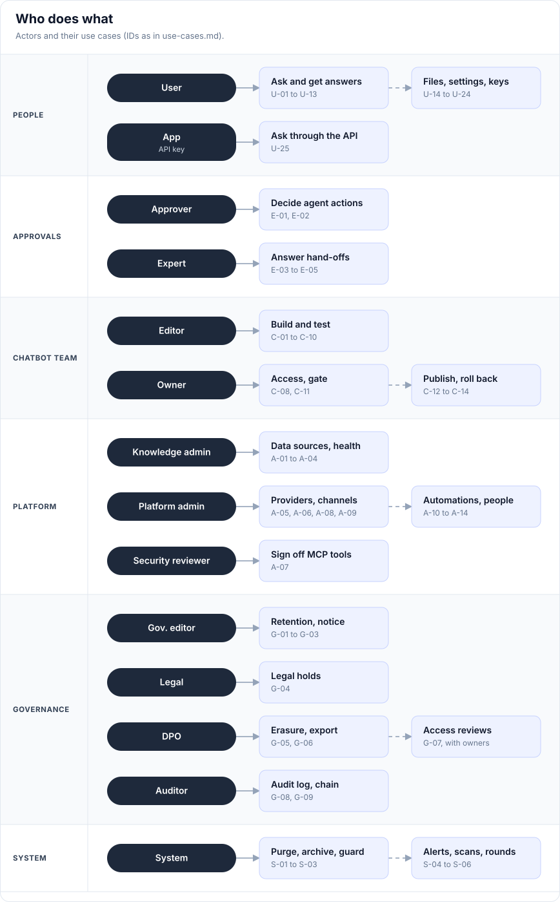
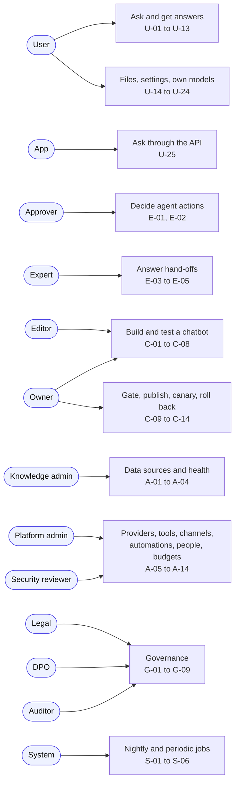

# Veyntora · Use cases

Every use case the app supports today, by actor. Each one names who does it, what must be true first, the main steps, what can go differently, and the result.

> [!NOTE]
> Step-by-step pictures of the main flows are in [user-flows.md](user-flows.md). This page is the complete list; the flows page is the visual walk-through.

## Contents

- [Actors](#actors)
- [Use case map](#use-case-map)
- [Catalogue](#catalogue) (all 73 at a glance)
- [People who use assistants](#people-who-use-assistants) · U-01 to U-25
- [Approvers and experts](#approvers-and-experts) · E-01 to E-05
- [Chatbot owners and editors](#chatbot-owners-and-editors) · C-01 to C-14
- [Platform and knowledge admins](#platform-and-knowledge-admins) · A-01 to A-14
- [Governance: Legal, DPO, auditors](#governance-legal-dpo-auditors) · G-01 to G-09
- [Automatic: what the system does on its own](#automatic-what-the-system-does-on-its-own) · S-01 to S-06

## Actors

| Actor | Who | Gets the role from |
| --- | --- | --- |
| **User** | Anyone given a chatbot | A group with the chatbot's User role |
| **Approver** | Decides agent actions | The chatbot's Approver role or a tool policy's approver group |
| **Expert** | Answers hand-off questions | A chatbot's expert group (Access page) |
| **Editor** | Shapes a chatbot's draft | The chatbot's Editor role |
| **Owner** | Publishes and controls access | The chatbot's Owner (Chatbot admin) role |
| **Knowledge admin** | Runs data sources | Platform role |
| **Security reviewer** | Signs off MCP tools | Platform role |
| **Platform admin** | Runs the install | The Keycloak bootstrap group |
| **Auditor** | Reads everything, changes nothing | Platform role |
| **Legal** | Places and lifts legal holds | Platform role, granted on the Governance page |
| **DPO** | Approves erasures and exports | Platform role, granted on the Governance page |
| **App** | Another system (CRM, ticketing) | An app key with its own service identity |
| **System** | Workers and the scheduler | Runs on its own |

## Use case map

Mermaid source

## Catalogue

| ID | Use case | Actor |
| --- | --- | --- |
| U-01 | Sign in | User |
| U-02 | Pick an assistant and ask a question | User |
| U-03 | Choose Auto, Fast or Agent mode | User |
| U-04 | Check an answer's sources | User |
| U-05 | Ask a follow-up question | User |
| U-06 | Rate an answer | User |
| U-07 | Report a wrong source | User |
| U-08 | Ask an expert when there is no answer | User |
| U-09 | Let the agent take an action (with approval) | User |
| U-10 | Stop an agent run | User |
| U-11 | Save an answer | User |
| U-12 | Share a saved answer or a chat | User |
| U-13 | Copy, regenerate or export | User |
| U-14 | Find an earlier chat | User |
| U-15 | Upload files to My files | User |
| U-16 | Ask about one document | User |
| U-17 | Read notifications | User |
| U-18 | Set answer preferences | User |
| U-19 | Bring your own model and key | User |
| U-20 | Link Teams or Slack | User |
| U-21 | Ask in Teams or Slack | User |
| U-22 | Ask through the website widget | User |
| U-23 | Export my data, or stop keeping history | User |
| U-24 | Check system status and help | User |
| U-25 | Ask through the API | App |
| E-01 | Decide an agent's action | Approver |
| E-02 | Correct a draft before approving | Approver |
| E-03 | Take and answer an expert question | Expert |
| E-04 | Offer an expert answer to the knowledge base | Expert |
| E-05 | Accept an expert answer into the knowledge base | Owner, knowledge admin |
| C-01 | Create a chatbot with the wizard | Platform admin, owner |
| C-02 | Attach knowledge to a chatbot | Editor |
| C-03 | Tune the pipeline | Editor |
| C-04 | Set guardrails | Editor |
| C-05 | Configure the agent and router | Editor |
| C-06 | Build a custom flow | Editor |
| C-07 | Test in the Playground | Editor |
| C-08 | Set access, expert groups and the data rule | Owner |
| C-09 | Build an eval set | Editor, owner |
| C-10 | Run an evaluation | Editor, owner |
| C-11 | Set the publish gate | Owner |
| C-12 | Publish through a canary | Owner |
| C-13 | Stop a canary or roll back | Owner |
| C-14 | Duplicate, pause or open a chatbot as a user | Owner |
| A-01 | Connect a data source | Knowledge admin |
| A-02 | Sync, re-index, pause or remove a source | Knowledge admin |
| A-03 | Change who may read a source | Knowledge admin |
| A-04 | Act on knowledge health findings | Knowledge admin, owner |
| A-05 | Add a provider and store its key | Platform admin |
| A-06 | Rotate or replace a key | Platform admin |
| A-07 | Register and sign off an MCP server | Security reviewer |
| A-08 | Open a channel: widget and API | Platform admin |
| A-09 | Create an app key | Platform admin |
| A-10 | Create an automation | Platform admin |
| A-11 | Run, follow and pause automations | Platform admin |
| A-12 | Manage people and groups | Platform admin |
| A-13 | Set budgets and per-person limits; export usage | Platform admin |
| A-14 | Watch the overview, monitoring and reviews | Platform admin |
| G-01 | Set retention and personal-data rules | Governance editor |
| G-02 | Write the AI notice | Governance editor |
| G-03 | Grant the Legal and DPO roles | Platform admin |
| G-04 | Place or lift a legal hold | Legal |
| G-05 | Handle an erasure request | Governance editor, DPO |
| G-06 | Handle an access (export) request | Governance editor, DPO |
| G-07 | Run an access review | Owners, platform admin |
| G-08 | Search and export the audit log | Auditor, platform admin |
| G-09 | Verify the audit chain and archive | Auditor, platform admin |
| S-01 | Purge data past its retention | System |
| S-02 | Archive the audit log write-once | System |
| S-03 | Guard a canary | System |
| S-04 | Alert on budgets | System |
| S-05 | Scan knowledge health overnight | System |
| S-06 | Start access review rounds | System |

---

## People who use assistants

### U-01 · Sign in

| | |
| --- | --- |
| **Actor** | User |
| **Before** | The person has a company account in Keycloak |
| **Result** | Home shows the assistants the person may use |

1. Open Veyntora and choose **Sign in**.
2. Sign in with the company account (single sign-on).
3. Read the AI notice and land on Home.

- **No assistant yet:** Home says "No assistants yet" and asks the person to contact their admin.
- **Suspended account** (for example, disabled in Keycloak): every request is refused with "Account suspended".

### U-02 · Pick an assistant and ask a question

| | |
| --- | --- |
| **Actor** | User |
| **Before** | Signed in, with the User role on at least one live chatbot |
| **Result** | A grounded answer with numbered citations, or "No answer found" |

1. On Home, pick an assistant.
2. Type the question and press **Ask**.
3. Watch the progress ("Searching the documents…", "Writing the answer…").
4. Read the answer; each fact carries a number linking to its source.

- **Not grounded:** "No answer found" is shown instead, with **Ask an expert** (U-08).
- **Partly supported:** a warning says parts may not be supported; check the cited documents.
- **External model used:** the answer is marked "External model", as the chatbot's data rule allows.
- **Over a limit or budget:** the question is refused with the reason, or Agent mode is switched off (A-13).

### U-03 · Choose Auto, Fast or Agent mode

| | |
| --- | --- |
| **Actor** | User |
| **Before** | The chatbot offers more than one mode |
| **Result** | The question runs in the chosen mode |

1. Pick the answer mode next to the question box: **Auto**, **Fast** or **Agent**.
2. Ask.

- **Auto:** the router picks Fast or Agent; a weak Fast answer is handed to the agent, and the chat says why.
- **Agent:** the person sees each step (searched, called a tool, waiting for approval) when "Show agent steps" is on.
- **Agent over the daily limit or budget:** only Fast runs.

### U-04 · Check an answer's sources

| | |
| --- | --- |
| **Actor** | User |
| **Before** | An answer with citations |
| **Result** | The person sees the exact passage the answer used |

1. Click a citation number.
2. The source viewer opens on the cited passage, with the page.
3. Optionally **Open original** in its system.

- The viewer opens only documents the person has read access to.

### U-05 · Ask a follow-up question

1. Ask again in the same chat, or click a suggested follow-up question.
2. Follow-ups such as "and for e-books?" are rewritten into a full question before searching (when the pipeline has it on).

### U-06 · Rate an answer

| | |
| --- | --- |
| **Actor** | User |
| **Result** | The rating feeds monitoring, conversation review and eval sets |

1. Press **Helpful** or **Not helpful**.
2. For Not helpful, pick what was wrong: wrong answer, outdated, incomplete, not relevant.

### U-07 · Report a wrong source

1. In the source viewer, choose **Report wrong source**.
2. Pick the reason (wrong, outdated, contradicts another document, something else) and add a comment.
3. The document's owners are told. They see the report, not the conversation. It appears under Knowledge health as "Reported by readers".

### U-08 · Ask an expert when there is no answer

| | |
| --- | --- |
| **Actor** | User |
| **Before** | The chatbot has an expert group (Access page) |
| **Result** | The question waits with the expert team; the reply appears in the chat |

1. Under "No answer found", choose **Ask an expert**.
2. Check the question, pick the team (one is suggested), the urgency (today or within 2 working days).
3. Choose whether to include the conversation and its sources, and where to get the reply (this chat, Teams, e-mail).
4. **Send to expert**.

- **No expert group set up:** the page says so and asks the person to contact the chatbot's owner.
- My questions and their status (open, being answered, answered, closed) are listed under Expert questions.

### U-09 · Let the agent take an action (with approval)

| | |
| --- | --- |
| **Actor** | User |
| **Before** | Agent mode; the chatbot has a tool marked write or destructive |
| **Result** | The action runs only after an approver says yes |

1. Ask in Agent mode for something that needs a change (for example, a ticket update).
2. The chat shows "Waiting for approval" with the tool and its server.
3. An approver decides (E-01). The answer continues in the chat.

- **Rejected or no decision in 24 hours:** the agent goes on without the action and says so.
- The person cannot approve their own request.

### U-10 · Stop an agent run

1. While the agent works or waits, press **Stop**.
2. The run ends; nothing waiting for approval is carried out.

### U-11 · Save an answer

1. Press **Save answer** (bookmark).
2. Find it under **Saved answers**.

- A chat with a saved answer is kept from retention purges while the answer is saved.

### U-12 · Share a saved answer or a chat

| | |
| --- | --- |
| **Actor** | User |
| **Result** | Colleagues see the answer, but only if they may open its sources |

1. A saved answer: **Share with team**, pick a group or everyone who may use the assistant, optionally "Refresh when sources change".
2. A chat: **Share**, pick only people I add, my team, or anyone with access to the assistant; choose whether to include sources; **Copy link**.

- **A colleague without access to a source:** that answer is hidden from them, with the reason.
- **Source changed since saving:** the answer is marked stale; **Refresh answer** rebuilds it.

### U-13 · Copy, regenerate or export

- **Copy answer**, **Regenerate**, **Export chat**, **Delete chat** from the chat's options.

### U-14 · Find an earlier chat

1. Open **Chats & knowledge** (Library).
2. Search chats by text; open one to continue.

### U-15 · Upload files to My files

| | |
| --- | --- |
| **Actor** | User |
| **Result** | The files are searchable by this person's chats only |

1. Open **My files**, or attach files in the chat.
2. Up to 200 files per upload; each is checked against the size and personal storage limit.
3. Each file is virus-scanned, then parsed and indexed: Not indexed yet → Ready.

- **Over the limit:** refused, nothing stored.
- **Virus found:** never indexed. **Parse error:** shown as Failed.
- **Remove** takes the file out of every index.

### U-16 · Ask about one document

1. In the source viewer, choose **Ask about this document**.
2. A chat starts focused on that document.

### U-17 · Read notifications

1. Open **Notifications**: approvals, hand-offs, reports.
2. See where each was also sent (Teams, Slack, e-mail) and whether delivery worked.
3. **Mark all as read**.

### U-18 · Set answer preferences

1. In **Settings**, choose the default mode, answer language, answer length and default assistant.
2. Turn agent steps and follow-up suggestions on or off.
3. Choose to also get notifications in Teams/Slack or by e-mail. **Save**.

### U-19 · Bring your own model and key

| | |
| --- | --- |
| **Actor** | User |
| **Before** | An admin allows own keys in a chatbot's data rule |
| **Result** | That chatbot answers this person with their own model; the key is never shown again |

1. In **Settings › My API keys**, add a model: OpenAI-compatible (public HTTPS endpoint) or Anthropic, the model, the key and an expiry.
2. Veyntora checks the endpoint and tests the key before storing it in OpenBao.
3. Afterwards only the last 4 characters and the expiry are shown.

- **Endpoint not public HTTPS, or key fails the test:** not saved, with the reason.
- **Own model fails later:** the chatbot's own model answers.
- Replace the key with a grace period, or remove it.

### U-20 · Link Teams or Slack

1. Write to the assistant in Teams or Slack; the bot replies with a one-time link.
2. Open the link, sign in, confirm the account.

### U-21 · Ask in Teams or Slack

1. Ask the bot in a chat or channel.
2. It answers with the linked person's access and sources; each new conversation starts with the AI notice.

- **Not linked:** the bot sends the one-time link (U-20) first.

### U-22 · Ask through the website widget

1. On an allowed intranet page, open the widget and **Sign in** in the pop-up.
2. Ask; answers only use documents the person may open.

- **Page not on the allowed list, or chatbot not live:** the widget does not load.
- **No access to this assistant:** "You cannot use this assistant here."

### U-23 · Export my data, or stop keeping history

1. **Export my data** in Settings builds a ZIP of profile, chats, saved answers, feedback and uploads.
2. Turning off **Keep chat history** deletes chats after one day (chats with a saved answer stay).

### U-24 · Check system status and help

1. **Status** shows each part (chat and answers, agent mode, document updates…) and any status message posted by admins.
2. **Help** explains modes, checking answers, and links the privacy notice.

### U-25 · Ask through the API

| | |
| --- | --- |
| **Actor** | App |
| **Before** | An app key (A-09); the chatbot's API channel is on |
| **Result** | An answer with sources, using only the key's own access |

1. The app calls the API with its key.
2. The question runs with the key's service identity, groups and chatbot roles; never a person's access.

- **Over the key's rate limit, or the key expired:** refused.

---

## Approvers and experts

### E-01 · Decide an agent's action

| | |
| --- | --- |
| **Actor** | Approver |
| **Before** | A request waits under **Approvals › To decide** |
| **Result** | Approved: the tool runs and is audited. Rejected: the agent goes on without it |

1. Open the request: who asked, in which chatbot, the tool and its access level, what will happen, the agent's reasoning and sources.
2. Add a note (optional) and **Approve** or **Reject**.

- **Own request:** shown as "someone else decides it".
- **Two approvals needed** (automation steps): it shows "1 of 2 approvals given".
- **No decision in 24 hours:** it expires and counts as rejected.
- A named delegate may decide for an approver until a date.

### E-02 · Correct a draft before approving

1. When the action carries a draft (a message, a reply), edit it under "Draft (you may correct it before approving)".
2. Approve; the corrected draft is what is sent.

### E-03 · Take and answer an expert question

1. Under **Expert questions › Questions for my team**, open a question with its conversation and sources.
2. **Take this question**, write the answer, send.
3. The reply appears in the asker's chat, and in Teams or by e-mail if they chose that.

### E-04 · Offer an expert answer to the knowledge base

1. When answering, choose **Add to the knowledge base** and pick which groups may read it.
2. It goes to review (E-05).

### E-05 · Accept an expert answer into the knowledge base

1. A chatbot owner or knowledge admin opens **Expert answers to review**.
2. Accept: the answer becomes a document in the chatbot's "Expert answers" source, readable by exactly the chosen groups.

---

## Chatbot owners and editors

### C-01 · Create a chatbot with the wizard

| | |
| --- | --- |
| **Actor** | Platform admin, owner |
| **Result** | A draft chatbot, ready to test |

1. **+ New chatbot**.
2. **1 Basics & template**: name, short name, a template.
3. **2 Knowledge**: attach data sources.
4. **3 Pipeline**: retrieval and model.
5. **4 Access**: roles and the data rule.
6. **5 Test & publish**: try it, then publish (C-12).

### C-02 · Attach knowledge to a chatbot

1. On the chatbot's **Knowledge** tab, attach or detach data sources.
2. Every attached source's permissions apply on every question.

### C-03 · Tune the pipeline

| | |
| --- | --- |
| **Actor** | Editor |
| **Result** | A changed draft; live is not affected until publishing |

1. Open **Pipelines** for the chatbot and edit the draft by section:
   - **Ingestion:** parser, embedding instance, chunking, OCR, tables, image descriptions, metadata.
   - **Retrieval:** vector store, search type, top-k, dense weight, minimum matching terms, German compound splitting, query rewriting, metadata filter.
   - **Reranking:** reranker, fallback, sources passed to the model, minimum relevance, chunks per document, prefer newer.
   - **Generation:** LLM, temperature, max tokens, system prompt, citations, what to do when not grounded, answer language.
2. **Save draft** with a change note.

- **Changing the embedding instance** re-indexes every attached source.
- Permission filters are always added and cannot be removed.

### C-04 · Set guardrails

1. In **Pipelines › Guardrails**, choose input and output checks (personal-data masking, safety checks, a model judge).
2. Save the draft. The Playground shows each check as a step.

### C-05 · Configure the agent and router

1. **Agent**: the tools it may use, max steps and other limits.
2. **Router**: how Auto chooses between Fast and Agent.

### C-06 · Build a custom flow

1. On the chatbot's **Flow** page, turn on "Run this flow instead of the standard pipeline".
2. Add steps (search, rerank, generate, call a tool, an agent with a toolbox, a condition, a check), connect them, set branches (always, yes/no, fast/agent).
3. **Save draft**. The flow is validated before publishing.

### C-07 · Test in the Playground

| | |
| --- | --- |
| **Actor** | Editor |
| **Result** | Draft and live answers side by side, step by step; nothing is saved as a conversation |

1. Pick the chatbot, type a question, **Run both** (or **Run draft** when nothing is live).
2. Compare outcome, latency, tokens, groundedness, the top chunks and every step.

- Runs with the tester's own permissions. Agent and Auto runs are tested in chat and shown in Run trace.

### C-08 · Set access, expert groups and the data rule

| | |
| --- | --- |
| **Actor** | Owner |
| **Result** | Who may use, edit, approve and answer for the chatbot, and where its data may go |

1. On **Access**, give groups the User, Approver, Editor or Owner role.
2. Choose the expert groups for hand-offs.
3. Set the data rule: external providers allowed or not, masking, own keys allowed, chat retention.

- **Platform requires masking, or EU-only:** a rule that breaks it is refused when saved, at publish and on every run.

### C-09 · Build an eval set

1. **Evaluation › Manage eval sets › + New set**: for a chatbot or all.
2. Add cases: question, reference answer, documents that must be cited, expected tools, or "the right answer is no answer".
3. Or start from recent thumbs-down answers, a CSV import, or cases generated from a source's documents.
4. Review generated and feedback cases; only reviewed cases count.

### C-10 · Run an evaluation

1. Choose a judge model in Evaluation settings (an external judge only for chatbots whose data rule allows it).
2. **Run evaluation** on the draft or live with a set. It runs in the background with the starter's permissions.
3. Read faithfulness, answer relevance, context precision and recall, tool accuracy and cases passed, by version.

### C-11 · Set the publish gate

1. Owners choose the required sets and the minimums: faithfulness, relevance, max drop versus live.
2. Publishing and starting a canary then need a passing run of every required set on the exact draft.

### C-12 · Publish through a canary

| | |
| --- | --- |
| **Actor** | Owner |
| **Before** | Publish checks pass (data rule, EU-only, masking, valid flow, eval gate) |
| **Result** | The new version is live for everyone; the old one is one click away |

1. On **Versions**, **Start canary with the draft**: 10% of people get it.
2. Compare canary and live: helpful rate, thumbs down, no answer, blocked, p95 latency, cost per 1,000 answers.
3. **Increase to 50%**, then **Promote to 100%**.

- **Gate blocks the draft:** the page shows why. A platform admin may start it anyway with a reason, which is audited.
- The guard may roll back on its own (S-03).

### C-13 · Stop a canary or roll back

1. **Stop canary**: everyone returns to live; the canary's results are kept.
2. **Roll back to v*n***: any earlier published version, with a reason; a running canary stops.

### C-14 · Duplicate, pause or open a chatbot as a user

- **Duplicate:** a new draft with the same pipeline, optionally its sources and access; the duplicator becomes owner.
- **Pause chatbot** / **Make live again**.
- **Open as user:** opens the chatbot's chat.

---

## Platform and knowledge admins

### A-01 · Connect a data source

| | |
| --- | --- |
| **Actor** | Knowledge admin |
| **Result** | Documents indexed with their readers |

1. **+ Connect source**, pick the type: Upload, SharePoint Online, Confluence, File share (SMB), S3 bucket, Website, Database.
2. Enter the settings and the secret (written to OpenBao, never shown again), the sync schedule and, where needed, the group mapping.
3. **Connect and test**, then the first sync runs.

- **Test fails:** fix the settings and test again.
- **Upload source:** no test; upload files.
- **Permissions that cannot be mapped are dropped**; a document without readers is visible to nobody.

### A-02 · Sync, re-index, pause or remove a source

- **Sync now**, or wait for the schedule (manual, hourly, every 4 hours, daily).
- **Re-index**, **Pause** / **Resume**, **Remove**.
- **Replace secret** when it expires.

### A-03 · Change who may read a source

1. For sources without their own permissions, choose the readers (groups); for databases, optionally a column naming a group per row.
2. **Save readers**: search uses the new readers at once; chunks are updated in the background.

### A-04 · Act on knowledge health findings

1. Open **Knowledge health**: gaps (from unanswered questions), contradictions, stale but popular documents, duplicates, parse failures, reader reports.
2. Ask the document's owner to update, or fix the source.

- Nothing changes on its own; findings are suggestions.

### A-05 · Add a provider and store its key

1. **+ Add provider**: the capability, the adapter, self-hosted or external.
2. Endpoint, model, key (write-only) and expiry.
3. **Test connection**: Healthy, Degraded or Down.

- **External provider:** usable only by chatbots whose data rule allows it.

### A-06 · Rotate or replace a key

1. **Replace key** with a new value and a grace period.
2. The old key keeps working until the grace period ends; the page shows only the new last 4 characters and expiry.

### A-07 · Register and sign off an MCP server

| | |
| --- | --- |
| **Actor** | Security reviewer |
| **Result** | Reviewed tools agents can use, each checked against its policy on every call |

1. **+ Register MCP server**: URL, transport, where it runs, authentication.
2. **Connect & discover tools**.
3. For each tool: read the description for hidden instructions; mark it read, write or destructive; choose approvers and who may use it.
4. **Sign off**, then **Enable**.

- **Discover again** after the server changes. **Disable** a server at any time.

### A-08 · Open a channel: widget and API

1. On **Channels & API**, switch the web app, widget and API on or off per chatbot.
2. Widget: allowed websites, position, theme; copy the snippet into the page.

### A-09 · Create an app key

1. **+ Create app key**: the chatbots it may use, a rate limit per minute, an expiry.
2. Give its service identity groups or chatbot roles like a person.

### A-10 · Create an automation

| | |
| --- | --- |
| **Actor** | Platform admin |
| **Result** | A draft automation; nothing runs until it is activated |

1. **+ New automation**: describe what should happen (a draft with steps is created), or start from a template: triage new tickets, weekly report, extract from new documents, deadline watcher, meeting brief, or from scratch.
2. Choose the chatbot whose live pipeline and data rules agent steps use.
3. Set the trigger: schedule, event (webhook), new file in a data source, or watcher.
4. Add agent, approval and notify steps; choose the autonomy.
5. **Test with sample**, or a **Dry run**; then activate.

### A-11 · Run, follow and pause automations

1. **Run now** (optionally with JSON input, or as a dry run).
2. Follow the run trace: steps, approvals, tool calls, messages and their delivery, tokens and cost.
3. **Pause** / **Resume** one; **Pause all** in an incident.

### A-12 · Manage people and groups

1. Groups come from Keycloak, rules, or are made by hand: **+ New group**, add members.
2. Give groups chatbot roles; check a person's effective access; list people without any access.
3. Suspend a person.

### A-13 · Set budgets and per-person limits; export usage

1. Per-person limits: questions per hour, Agent runs per day, upload storage; groups can get a multiple.
2. Budgets for a chatbot, group or cost centre, per month, quarter or year, with an action (block, Fast only, smaller model, notify) and a warning share.
3. Read spend and tokens by cost centre, chatbot, group, provider or app key; **Export for finance** (CSV, audited).

### A-14 · Watch the overview, monitoring and reviews

1. **Overview:** today's numbers and **Needs attention**; post a status message (information, planned maintenance, incident) for users.
2. **Monitoring:** requests by mode, p95 latency, helpful rate, blocked answers, failed runs, external calls; open Langfuse or Grafana.
3. **Conversations review:** rated answers with personal data masked; filter by what went wrong; open (audited), mark reviewed, add to an eval set, ask a document owner to update.

---

## Governance: Legal, DPO, auditors

### G-01 · Set retention and personal-data rules

1. On **Governance**, set retention for chats, traces, uploads and the audit log (at least 365 days).
2. Turn on masking in traces and reviews, masking before any external provider, EU-only external providers.

- Only Governance editors change these settings.

### G-02 · Write the AI notice

1. Write the notice text and save.
2. It appears on sign-in, in the chat footer and in new Teams or Slack conversations.

### G-03 · Grant the Legal and DPO roles

1. A platform admin grants the platform roles to groups on the Governance page.
2. Platform admins cannot place holds or approve erasures themselves.

### G-04 · Place or lift a legal hold

| | |
| --- | --- |
| **Actor** | Legal |
| **Result** | Nothing of the named people and chatbots is removed by retention or erasure |

1. **Place hold**: name, reason, people (e-mail addresses), chatbots.
2. **Lift** when the matter ends; lifted holds stay in the history.

### G-05 · Handle an erasure request

| | |
| --- | --- |
| **Actor** | Governance editor or DPO records; a different DPO approves |
| **Result** | The person's data is removed; a signed report is kept |

1. Record the request; the page shows what is held about the person.
2. Mark the identity as verified.
3. A DPO who is not the requester approves.
4. Carry it out: chats, saved answers, notifications, channel links and own keys deleted; uploads removed from every index; eval cases masked; usage kept without the person; account scrubbed and suspended; audit name pseudonymised; Langfuse traces deleted.
5. Download the HMAC-signed report (audited).

- **Legal hold on the person:** blocked until Legal lifts it.

### G-06 · Handle an access (export) request

1. Same steps 1 to 3 as G-05.
2. The workers build the ZIP; download it (audited) with the signed report.

### G-07 · Run an access review

1. A round starts every N days (default 90) or by hand.
2. Chatbot owners review chatbot roles; group owners review manual memberships; items without an owner go to platform admins.
3. Each grant: **Keep** or **Revoke** (audited). A chatbot never loses its last owner this way.
4. A platform admin closes the round.

- **Nobody decides:** access stays; platform admins are told once and the round shows overdue.

### G-08 · Search and export the audit log

1. Search by text, category and date range; open an entry to see who, what and the diff.
2. Export as CSV or JSON lines with hashes, masked by default; the export is audited.

### G-09 · Verify the audit chain and archive

1. The page shows "Chain intact" or the first broken entry.
2. It shows how far the write-once archive reaches and until when it is locked.

---

## Automatic: what the system does on its own

| ID | Use case | When | What happens |
| --- | --- | --- | --- |
| S-01 | Purge data past its retention | Nightly | Old chats, uploads and Langfuse traces are removed; saved answers and legal holds are respected |
| S-02 | Archive the audit log write-once | Nightly | New entries go to an S3 Object Lock bucket; only archived entries past retention are ever trimmed |
| S-03 | Guard a canary | Every 5 minutes | A canary clearly worse than live is rolled back and owners are told (owners can turn it off) |
| S-04 | Alert on budgets | Every few minutes | Owners are told once per period at the warning share and at the limit |
| S-05 | Scan knowledge health | Overnight | Gaps, contradictions, stale documents, duplicates and parse failures are listed |
| S-06 | Start access review rounds | Every N days | A new round starts and owners are told |
