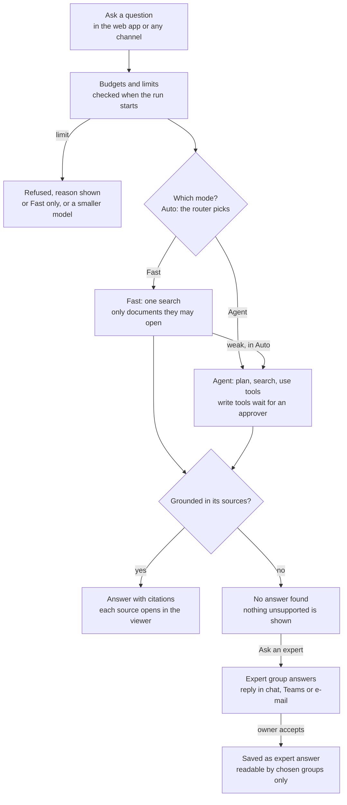
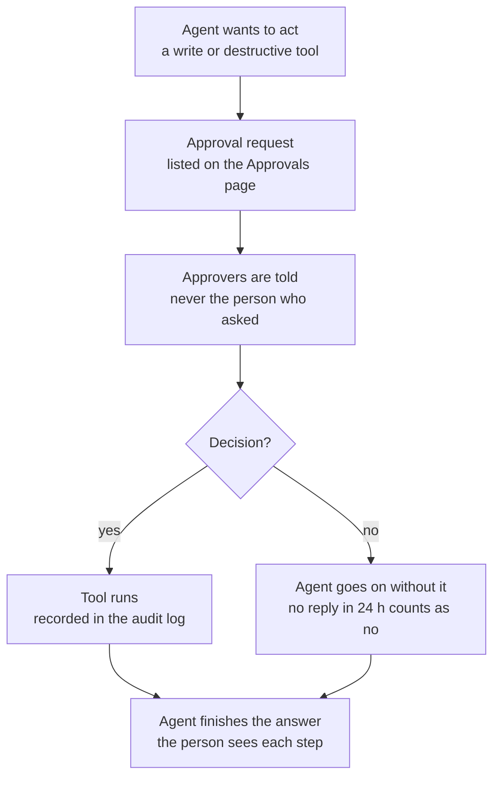
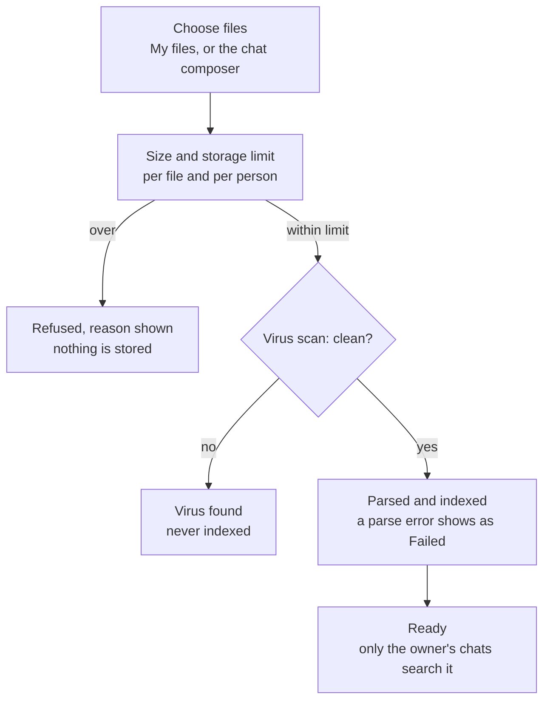
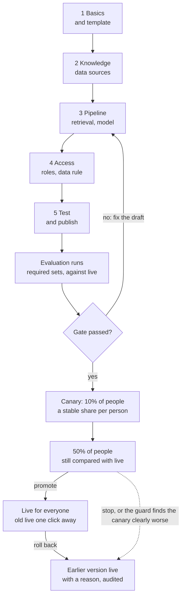
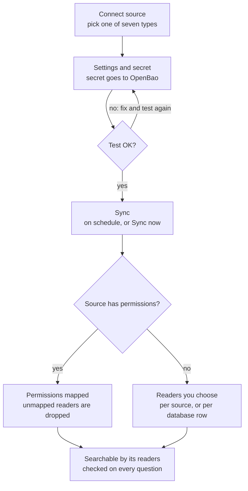
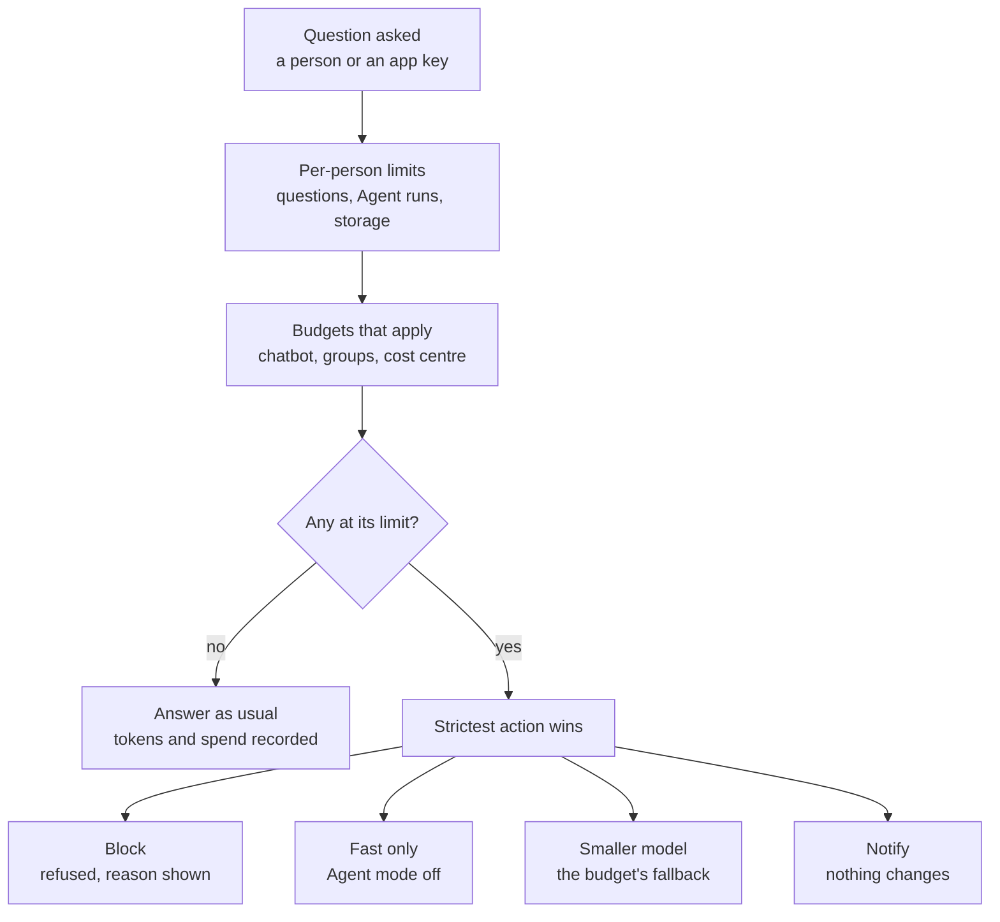
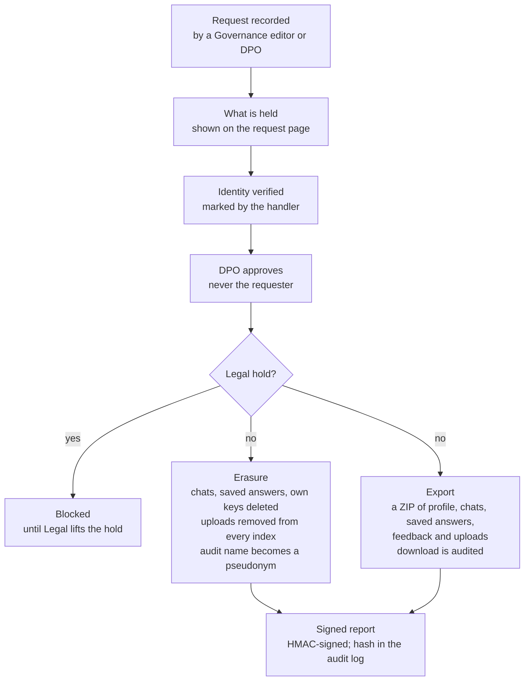

# Veyntora user and admin flows

Every path a person takes through Veyntora, from asking a question to approving an erasure. Flows that branch or change hands are drawn; straight runs are numbered steps.

The same content, with editable diagrams, is in the shared doc "Veyntora user and admin flows". Keep both in step when a flow changes.

## Who does what

People get roles through groups. Chatbot roles apply to one assistant; platform roles apply to the whole install.

| Role | Scope | What they can do | Where |
| --- | --- | --- | --- |
| User | Chatbot | Chat, upload own files, save and share answers, ask an expert | Home, Chat, Saved, Settings |
| Approver | Chatbot | Approve or reject the agent's actions; never their own requests | Approvals |
| Editor | Chatbot | Change content and the draft pipeline, test in the Playground | Admin › Chatbots, Pipelines |
| Owner | Chatbot | Everything an editor can, plus publish and manage access | Admin › Chatbots › Versions, Access |
| Knowledge admin | Platform | Manage data sources and knowledge health | Admin › Data sources |
| Security reviewer | Platform | Manage tools (MCP) and their policies | Admin › Tools |
| Auditor | Platform | Read every admin page and the audit log, change nothing | Admin › Audit log |
| Legal | Platform | Place and lift legal holds | Admin › Governance |
| Data protection officer | Platform | Approve erasures and exports; never their own requests | Admin › Governance |
| Platform admin | Platform | Everything except legal holds and DPO approvals | Admin console |

Platform admins come from the bootstrap group in Keycloak; they grant the Legal and DPO roles to groups on the Governance page.

## Asking a question

An answer is shown only when its sources support it.

Every step loads the person's access again, so an answer only draws on documents they may open. In Auto, a weak Fast answer is handed to the agent. An answer whose sentences its cited sources do not support is never shown; the person can pass the question to the chatbot's expert group instead. An expert may offer the reply to the knowledge base, and once an owner accepts it the assistant can use it next time, for the chosen groups only.

## Agent actions that need approval

The agent writes nothing until an approver says yes.

Approvers are the tool policy's approver group, or platform admins when the policy names none; a delegate named until a date may decide for them. The agent reads the decision from the database when it resumes, so no client message can approve anything. The person who asked can also cancel the run while it waits.

## My files

A file is searchable only after a clean scan, and only by its owner.

Up to 200 files per upload. Nobody else can read a person's files, admins included. Removing a file queues a delete job that takes it out of every index; the governance upload retention can also remove old files overnight.

## Other user flows

These run in a straight line; access rules apply in every one.

**Sign in**

1. Open Veyntora and choose Sign in.
2. Sign in with the company account (Keycloak single sign-on).
3. Read the AI notice, then land on Home with the assistants you may use.

**Save and share an answer**

1. In a chat, save an answer with the bookmark button.
2. On Saved answers, choose Share with team, then pick a group or everyone who may use the assistant.
3. Optionally turn on "Refresh when sources change".
4. Colleagues see the answer only if they may open its sources themselves.
5. When a source changes, the answer is marked stale; Refresh answer rebuilds it from the latest documents.

**Notifications**

1. Approvals, hand-offs and reports always appear under Notifications.
2. In Settings, a person can also send them to their Teams or Slack chat, or by email.

**Settings: answers**

1. Choose the default mode (Auto, Fast or Agent), answer language, answer length and default assistant.
2. Choose whether to show agent steps and suggest follow-up questions, then Save.

**Settings: own models (bring your own key)**

1. Shown only when an admin allows own keys on an assistant's data rule.
2. Add a model: OpenAI-compatible (public HTTPS endpoint) or Anthropic (Anthropic's API only), the model name, the key and an expiry.
3. Veyntora tests the key against the endpoint before storing it in OpenBao.
4. Afterwards only the last 4 characters and the expiry are shown; the key is never shown again.
5. Replace the key (with a grace period) or remove it. If the own model fails, the assistant's own model answers.

**Link Teams or Slack**

1. Write to the assistant in Teams or Slack; the bot replies with a one-time link.
2. Open the link, sign in, and confirm the account to link.
3. The bot now answers with that person's access. Each new conversation starts with the AI notice.

**Website widget**

1. On an allowed intranet page, open the widget and choose Sign in.
2. Sign in with the company account in the pop-up, then close it.
3. Ask as in the web app; answers only use documents the person may open.

**Privacy**

1. Export my data builds a ZIP of profile, chats, saved answers, feedback and uploads.
2. Turning off "Keep chat history" deletes chats after one day (chats with a saved answer stay).
3. Delete chats removes them with their messages, citations and feedback.

## A chatbot's life

A draft reaches everyone only through the eval gate and a canary.

Editors change the draft (pipeline editor, guardrails, router) and try it in the Playground; only owners publish. The gate requires every required eval set's latest run on the exact draft to pass faithfulness and relevance minimums without dropping too far below live. A platform admin may override the gate with an audited reason; the other publish checks (data rule, EU-only, masking) can never be overridden. The guard checks every 5 minutes and tells the owners when it rolls back; owners can switch it off per chatbot.

## Data sources

Every document carries its readers from the first sync.

| Type | Readers come from |
| --- | --- |
| SharePoint Online | Site and library permissions, mapped to Veyntora groups or matching e-mails |
| Confluence (Cloud and Data Center) | Space permissions narrowed by page restrictions |
| File share (SMB) | NTFS permissions (DACL), mapped through a SID map |
| Upload | Chosen by the admin |
| S3 bucket | Chosen by the admin |
| Website | Chosen by the admin |
| Database (read-only query) | Chosen by the admin, or per row from a column naming a group |

Upload sources skip the test: create the source, then upload files. A document whose readers cannot be mapped is visible to nobody. A permission change on an unchanged document queues a permission sync. Each source page shows its documents, last sync and status, and offers Re-index, Pause and Remove.

## Admin setup flows

Every change here is recorded in the audit log.

**Providers and keys** (Admin › Providers)

1. Choose "+ Add provider", then what it should do: LLM, embeddings, reranker, vector store, document parser or guardrail.
2. Choose the adapter (for example TEI, Docling, Qdrant, Anthropic, OpenAI-compatible) and declare it self-hosted or external.
3. Enter the endpoint, model and key. The key goes straight to OpenBao and is never shown again.
4. Test connection; the health shows as Healthy, Degraded or Down.
5. To rotate, choose Replace key and a grace period. The page only ever shows the last 4 characters and the expiry.
6. An external provider is usable only by chatbots whose data rule allows it.

**Tools (MCP)** (Admin › Tools, security reviewer)

1. Choose "+ Register MCP server": URL, transport, where it runs and authentication (none, API key, OAuth service account, or the user's token).
2. Connect & discover tools.
3. Review each tool: read its description for hidden instructions, mark it read, write or destructive, choose approvers and who may use it.
4. Sign off, then enable. Every call is checked against the tool's policy and the user's permissions.

**Channels and API** (Admin › Channels & API)

1. Per chatbot, switch the web app, website widget and API on or off.
2. Widget: list the allowed websites, choose position and theme, copy the snippet into the page before `</body>`.
3. App keys: "+ Create app key" for another system. Each key has its own service identity with its own groups or chatbot roles, a rate limit and an expiry.

**Automations** (Admin › Automations)

1. "+ New automation", from a description or a template.
2. Set the trigger: a schedule or an event.
3. Add steps: agent steps and approval steps (an approval step sets its own time limit, may escalate once, may need two people).
4. Choose the autonomy: Suggest only, Act with approval, or Act and report (changing data always needs an approval).
5. Try a dry run, which takes no actions and asks no one. Then activate.
6. Follow runs: Queued, Running, Waiting for approval, Done, Failed or Stopped. Pause one, or Pause all in an incident.

**Users and groups** (Admin › Users & groups)

1. Identities come from Keycloak. Groups are Keycloak, rule-based or manual.
2. Create a group, add members, and give it chatbot roles: User, Approver, Editor or Chatbot admin (owner).
3. Check a person's effective access, or filter for people without any access.
4. Suspend a person when needed.

## Usage and budgets

When several budgets are at their limit, the strictest action wins.

Owners are told once per period: at the warning share and at the limit.

Per-person limits come first: over the questions-per-hour limit a question is refused, over the Agent-runs-per-day limit Agent mode switches off, and an upload over the storage limit is refused. Groups can get a multiple of these limits; automations are limited by budgets only.

**Set up and report** (Admin › Usage and budgets)

1. Create a budget for a chatbot, a group or a cost centre, per month, quarter or year.
2. Choose its action (block, Fast only, smaller model or notify) and the warning share.
3. Read spend and tokens by cost centre, chatbot, group, provider or app key, with the self-hosted and external share.
4. Export for finance as CSV; the export is recorded in the audit log.

## Watching quality

**Overview** (Admin home)

1. Read today's active users, conversations, the 7-day helpful rate and this month's spend.
2. Work through Needs attention: blocked, review, fix, soon, budget, canary and status items, each linking to its page.
3. Check System status and post a status message when a service is degraded.

**Monitoring**

1. Pick a time range (today, 7 or 30 days) and a chatbot.
2. Read requests by mode, p95 latency, helpful rate, blocked answers, failed runs and external calls.
3. Open Langfuse for a trace or Grafana for infrastructure.

**Conversations review**

1. Only rated answers are listed; personal data (e-mail, IBAN, phone and card numbers) is masked.
2. Filter by what went wrong: not helpful, low groundedness, no answer found, guardrail triggered.
3. Open an answer (recorded in the audit log), read it with its sources, and mark it reviewed.
4. Optionally add it to an evaluation set.

**Knowledge health**

1. Overnight scans find knowledge gaps, contradictions, stale but popular documents, duplicates, parse failures and reader reports.
2. Each finding is a suggestion; the document's owner decides. Nothing changes on its own.

## Data subject requests

Nothing is erased or exported without a second person, the DPO.

Requests live under Admin › Governance. Erasure also deletes notifications and channel links, masks eval cases taken from the person's answers, keeps usage numbers without the person, scrubs and suspends the account, and has the workers delete their Langfuse traces. A person can get the same export themselves with Export my data in Settings.

## Retention, legal holds, access reviews and audit

**Governance settings** (Governance editors)

1. Set retention in days for chats, traces, uploads and the audit log (at least 365).
2. Choose the personal-data rules: mask in traces and reviews, mask before any external provider, external providers only in EU regions.
3. Write the AI notice shown on sign-in, in the chat footer and in new Teams or Slack conversations.
4. Each night the purge removes what is older. Chats with a saved answer and anything under a legal hold stay.

**Legal holds** (Legal role only)

1. Place hold: a name, a reason, the people (e-mail addresses) and the chatbots.
2. While it is active, retention and erasure remove nothing of them.
3. Lift the hold when the matter ends; lifted holds stay in the history.

**Access reviews**

1. A round starts every 90 days by default (Governance settings), or by hand.
2. Chatbot owners review every chatbot role; group owners review every manual group membership. Items without an owner go to platform admins.
3. Each reviewer chooses Keep or Revoke per grant. A chatbot never loses its last owner this way.
4. Undecided access stays; platform admins are told once and the round shows as overdue.
5. A platform admin closes the round.

**Audit log** (read-only)

1. Search by text, category and date range.
2. Open an entry to see who did what, and the diff of what changed.
3. Check the chain: "Chain intact", or the first broken entry.
4. Export as CSV or JSON lines with hashes, masked by default; the export itself is audited.
5. Each night entries are archived write-once (S3 Object Lock). Only archived entries past the retention are ever removed.
