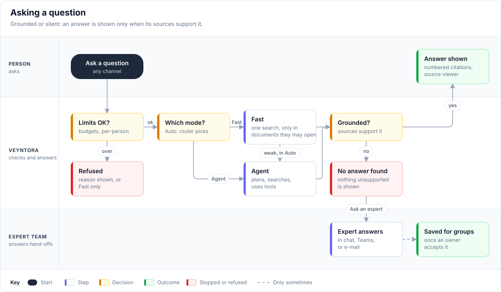
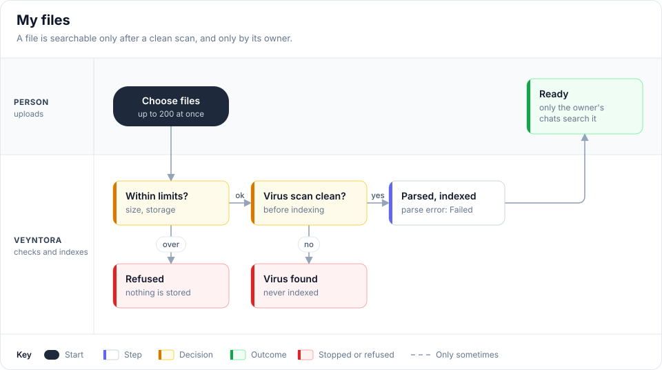
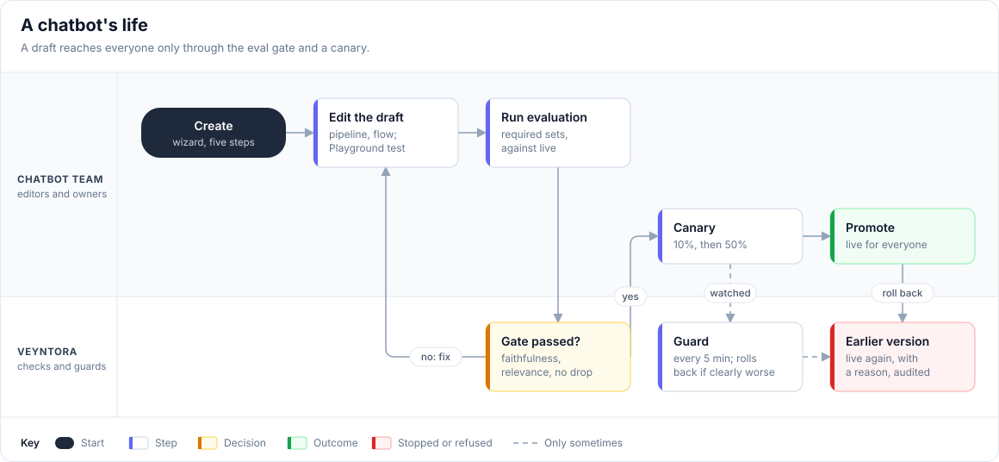
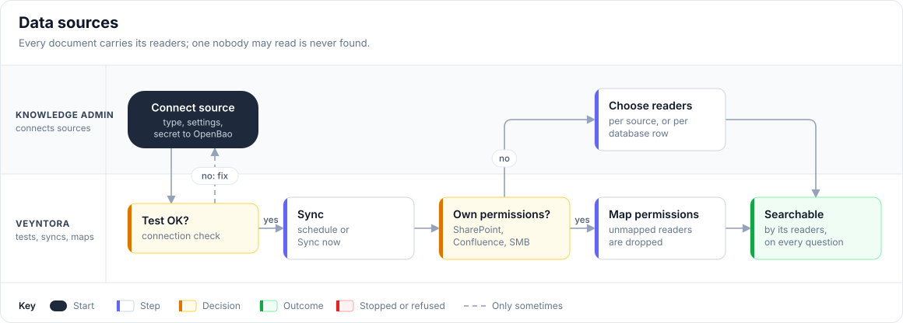
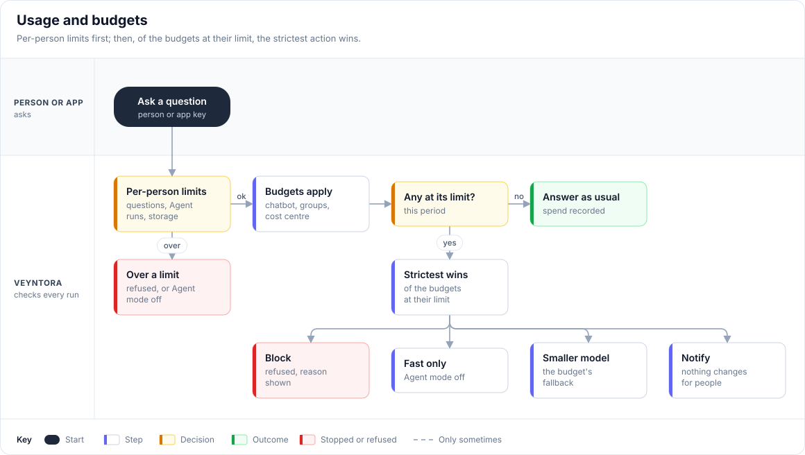
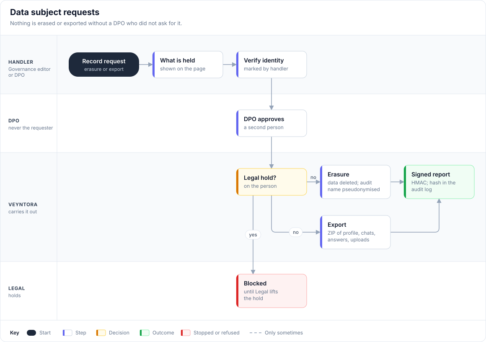

# Veyntora · User and admin flows

Every path a person takes through Veyntora, from asking a question to approving an erasure.
Flows that branch or change hands are drawn; straight runs are step tables.

> [!NOTE]
> The same content, with editable diagrams, is in the shared doc "Veyntora user and admin flows".
> When a flow changes, update both.
>
> Every use case, with its actors and exceptions, is listed in [use-cases.md](use-cases.md).
>
> The flowcharts are SVG images in [`docs/flows/`](flows/), drawn by [`docs/flows/diagrams.py`](flows/diagrams.py). To change one, edit it there and run `make docs-flows`.

## Contents

| Part 1 · People who use assistants | Part 2 · Admins | Part 3 · Governance |
| --- | --- | --- |
| [Asking a question](#asking-a-question) | [A chatbot's life](#a-chatbots-life) | [Data subject requests](#data-subject-requests) |
| [Agent actions that need approval](#agent-actions-that-need-approval) | [Data sources](#data-sources) | [Governance settings and retention](#governance-settings-and-retention) |
| [My files](#my-files) | [Providers and keys](#providers-and-keys) | [Legal holds](#legal-holds) |
| [Sign in](#sign-in) | [Tools (MCP)](#tools-mcp) | [Access reviews](#access-reviews) |
| [Save and share an answer](#save-and-share-an-answer) | [Channels and API](#channels-and-api) | [Audit log](#audit-log) |
| [Notifications](#notifications) | [Automations](#automations) | |
| [Settings](#settings) | [Users and groups](#users-and-groups) | |
| [Own models (bring your own key)](#own-models-bring-your-own-key) | [Usage and budgets](#usage-and-budgets) | |
| [Teams, Slack and the website widget](#teams-slack-and-the-website-widget) | [Watching quality](#watching-quality) | |
| [Privacy](#privacy) | | |

## The map

Admins prepare a chatbot on the left; people use it on the right.

Governance covers both sides: retention and masking, legal holds, data subject requests and the audit log.

**How to read the flowcharts**

| Colour | Meaning |
| --- | --- |
| 🟩 Green | The good outcome: what the flow is for |
| 🟨 Yellow | A decision or a check |
| 🟥 Red | Stopped or refused, with the reason shown |
| ⬜ Plain | A step |
| Dashed arrow | Happens only sometimes (a fallback, a stop, a guard) |

## Who does what

People get roles through groups. **Chatbot roles** apply to one assistant; **platform roles** apply to the whole install.

| Role | Scope | What they can do | Where |
| --- | --- | --- | --- |
| **User** | Chatbot | Chat, upload own files, save and share answers, ask an expert | Home, Chat, Saved, Settings |
| **Approver** | Chatbot | Approve or reject the agent's actions; never their own requests | Approvals |
| **Editor** | Chatbot | Change content and the draft pipeline, test in the Playground | Admin › Chatbots, Pipelines |
| **Owner** | Chatbot | Everything an editor can, plus publish and manage access | Admin › Chatbots › Versions, Access |
| **Knowledge admin** | Platform | Manage data sources and knowledge health | Admin › Data sources |
| **Security reviewer** | Platform | Manage tools (MCP) and their policies | Admin › Tools |
| **Auditor** | Platform | Read every admin page and the audit log, change nothing | Admin › Audit log |
| **Legal** | Platform | Place and lift legal holds | Admin › Governance |
| **Data protection officer** | Platform | Approve erasures and exports; never their own requests | Admin › Governance |
| **Platform admin** | Platform | Everything except legal holds and DPO approvals | Admin console |

Platform admins come from the bootstrap group in Keycloak. They grant the Legal and DPO roles to groups on the Governance page.

---

# Part 1 · People who use assistants

## Asking a question

> [!IMPORTANT]
> **Grounded or silent.** An answer is shown only when its cited sources support it, and only from documents the person may open.

- Every step loads the person's access again.
- In **Auto**, a weak Fast answer is handed to the agent.
- An expert may offer the reply to the knowledge base. Once an owner accepts it, the assistant can use it next time, for the chosen groups only.

## Agent actions that need approval

> [!IMPORTANT]
> **No write without approval.** The agent changes nothing until an approver says yes, and the approver is never the person who asked.

- **Who approves:** the tool policy's approver group, or platform admins when the policy names none. A delegate named until a date may decide for them.
- The agent reads the decision from the database when it resumes, so no client message can approve anything.
- The person who asked can cancel the run while it waits.

## My files

> [!IMPORTANT]
> A file is searchable only after a clean virus scan, and only by its owner. Admins cannot read it either.

- Up to **200 files** per upload.
- Removing a file queues a delete job that takes it out of every index.
- The governance upload retention can also remove old files overnight.

## Sign in

| # | You do | What happens |
| --- | --- | --- |
| 1 | Open Veyntora and choose **Sign in** | You go to the company sign-in (Keycloak single sign-on) |
| 2 | Sign in with the company account | Your groups decide which assistants you see |
| 3 | Read the **AI notice** | You land on **Home** with the assistants you may use |

## Save and share an answer

| # | You do | What happens |
| --- | --- | --- |
| 1 | In a chat, press the **bookmark** button | The answer is kept under **Saved answers** |
| 2 | Choose **Share with team** and pick a group, or everyone who may use the assistant | Colleagues see it only if they may open its sources themselves |
| 3 | Optionally turn on **Refresh when sources change** | A changed source marks the answer stale |
| 4 | Choose **Refresh answer** | It is rebuilt from the latest documents |

## Notifications

- Approvals, hand-offs and reports always appear under **Notifications**.
- In **Settings**, a person can also get them in their Teams or Slack chat, or by e-mail.

## Settings

| Setting | Choices |
| --- | --- |
| Default mode | Auto, Fast or Agent |
| Answer language | Same as my question, English, Deutsch |
| Answer length | Short, Balanced, Detailed |
| Default assistant | Any assistant you may use |
| Show agent steps while working | On or off |
| Suggest follow-up questions | On or off |

## Own models (bring your own key)

> [!NOTE]
> Shown only when an admin allows own keys in an assistant's data rule. An own model always counts as external.

| # | You do | What happens |
| --- | --- | --- |
| 1 | **Add a model**: OpenAI-compatible (public HTTPS endpoint) or Anthropic (Anthropic's API only), the model name, the key and an expiry | The endpoint is checked: public HTTPS only |
| 2 | Save | Veyntora tests the key against the endpoint, then stores it in OpenBao |
| 3 | Look at the key later | Only the **last 4 characters** and the **expiry** are shown; the key is never shown again |
| 4 | **Replace** the key (with a grace period) or **remove** it | If the own model fails, the assistant's own model answers |

## Teams, Slack and the website widget

**Link Teams or Slack**

| # | You do | What happens |
| --- | --- | --- |
| 1 | Write to the assistant in Teams or Slack | The bot replies with a one-time link |
| 2 | Open the link, sign in, confirm the account | The account is linked to you |
| 3 | Ask in Teams or Slack | The bot answers with your access; each new conversation starts with the AI notice |

**Website widget**

| # | You do | What happens |
| --- | --- | --- |
| 1 | On an allowed intranet page, open the widget and choose **Sign in** | A pop-up opens the company sign-in |
| 2 | Sign in, then close the pop-up | The widget knows who you are |
| 3 | Ask as in the web app | Answers only use documents you may open |

## Privacy

| Action | Effect |
| --- | --- |
| **Export my data** | A ZIP of profile, chats, saved answers, feedback and uploads |
| Turn off **Keep chat history** | Chats are deleted after one day; chats with a saved answer stay |
| **Delete chats** | Removed with their messages, citations and feedback |

---

# Part 2 · Admins

## A chatbot's life

> [!IMPORTANT]
> A draft reaches everyone only through the eval gate and a canary, and the old live version stays one click away.

| Who | Can do |
| --- | --- |
| Editors | Change the draft (pipeline editor, guardrails, router) and try it in the **Playground** |
| Owners | Publish, move the canary on, promote, stop and roll back |
| Platform admins | Override the eval gate, only with an audited reason |

- **The gate:** every required eval set's latest run on the exact draft must pass the faithfulness and relevance minimums, without dropping too far below live.
- **The other publish checks** (data rule, EU-only, masking) can never be overridden.
- **The guard** checks every 5 minutes and tells the owners when it rolls back. Owners can switch it off per chatbot.

## Data sources

> [!IMPORTANT]
> **Permission-aware retrieval.** Every document carries its readers from the first sync. A document whose readers cannot be mapped is visible to nobody.

| Type | Readers come from |
| --- | --- |
| SharePoint Online | Site and library permissions, mapped to Veyntora groups or matching e-mails |
| Confluence (Cloud and Data Center) | Space permissions narrowed by page restrictions |
| File share (SMB) | NTFS permissions (DACL), mapped through a SID map |
| Upload | Chosen by the admin |
| S3 bucket | Chosen by the admin |
| Website | Chosen by the admin |
| Database (read-only query) | Chosen by the admin, or per row from a column naming a group |

- Upload sources skip the test: create the source, then upload files.
- A permission change on an unchanged document queues a permission sync.
- Each source page shows its documents, last sync and status, and offers **Re-index**, **Pause** and **Remove**.

## Providers and keys

> [!CAUTION]
> **Secrets are write-only.** A key goes straight to OpenBao. No page, API, log or trace ever returns it; only its last 4 characters and expiry are shown.

| # | You do (Admin › Providers) | What happens |
| --- | --- | --- |
| 1 | **+ Add provider**, then what it should do: LLM, embeddings, reranker, vector store, document parser or guardrail | |
| 2 | Choose the adapter (for example TEI, Docling, Qdrant, Anthropic, OpenAI-compatible) and declare it self-hosted or external | An external provider is usable only by chatbots whose data rule allows it |
| 3 | Enter the endpoint, model and key | The key is written to OpenBao |
| 4 | **Test connection** | Health shows as Healthy, Degraded or Down |
| 5 | To rotate: **Replace key** and pick a grace period | The old key keeps working until the grace period ends |

## Tools (MCP)

Security reviewers, under Admin › Tools.

| # | You do | What happens |
| --- | --- | --- |
| 1 | **+ Register MCP server**: URL, transport, where it runs, authentication (none, API key, OAuth service account, or the user's token) | |
| 2 | **Connect & discover tools** | The server's tools are listed |
| 3 | Review each tool: read its description for hidden instructions, mark it read, write or destructive, choose approvers and who may use it | |
| 4 | **Sign off**, then **Enable** | Every call is checked against the tool's policy and the user's permissions |

## Channels and API

Admin › Channels & API.

| # | You do | What happens |
| --- | --- | --- |
| 1 | Per chatbot, switch the web app, website widget and API on or off | Access rules apply in every channel |
| 2 | Widget: list the allowed websites, choose position and theme, copy the snippet | Paste it before `</body>`; the widget loads nowhere else |
| 3 | **+ Create app key** for another system (CRM, ticketing) | The key gets its own service identity, groups or chatbot roles, a rate limit and an expiry; it never uses a person's access |

## Automations

Admin › Automations: agents that run on a schedule or when something happens.

| # | You do | What happens |
| --- | --- | --- |
| 1 | **+ New automation**, from a description or a template | A draft is created |
| 2 | Set the trigger: a schedule or an event | |
| 3 | Add agent steps and approval steps | An approval step sets its own time limit, may escalate once, may need two people |
| 4 | Choose the autonomy | See the table below |
| 5 | Try a **dry run** | Takes no actions and asks no one; shows what would happen |
| 6 | Activate, then follow runs | Queued, Running, Waiting for approval, Done, Failed or Stopped |

| Autonomy | Behaviour |
| --- | --- |
| Suggest only | Read tools only; actions and messages are only shown on the run |
| Act with approval | Every action and message waits for a person's approval |
| Act and report | Messages are sent without asking; changing data always needs an approval |

> [!TIP]
> In an incident, **Pause all** stops every automation until each is resumed by hand.

## Users and groups

Admin › Users & groups.

| # | You do | What happens |
| --- | --- | --- |
| 1 | Check identities and groups | Identities come from Keycloak; groups are Keycloak, rule-based or manual |
| 2 | Create a group and add members | |
| 3 | Give the group chatbot roles: User, Approver, Editor or Chatbot admin (owner) | Members get every role any of their groups gives them |
| 4 | Check a person's effective access, or filter for people without any access | |
| 5 | Suspend a person when needed | |

## Usage and budgets

> [!IMPORTANT]
> When several budgets are at their limit, the **strictest** action wins.

| Per-person limit | Over the limit |
| --- | --- |
| Questions per hour | The question is refused |
| Agent runs per day | Agent mode switches off; Fast keeps working |
| Upload storage | The upload is refused |

Groups can get a multiple of these limits. Automations are limited by budgets only. Owners are told once per period: at the warning share and at the limit.

**Set up and report** (Admin › Usage and budgets)

| # | You do | What happens |
| --- | --- | --- |
| 1 | Create a budget for a chatbot, a group or a cost centre, per month, quarter or year | |
| 2 | Choose its action (block, Fast only, smaller model or notify) and the warning share | |
| 3 | Read spend and tokens by cost centre, chatbot, group, provider or app key | The self-hosted and external shares are shown |
| 4 | **Export for finance** | A CSV downloads; the export is recorded in the audit log |

## Watching quality

| Page | What you do there |
| --- | --- |
| **Overview** (admin home) | Read active users, conversations, the 7-day helpful rate and this month's spend. Work through **Needs attention** (blocked, review, fix, soon, budget, canary, status). Post a status message when a service is degraded. |
| **Monitoring** | Pick a time range and a chatbot. Read requests by mode, p95 latency, helpful rate, blocked answers, failed runs and external calls. Open Langfuse for a trace or Grafana for infrastructure. |
| **Conversations review** | Only rated answers are listed, with personal data masked. Filter by what went wrong, open an answer (audited), mark it reviewed, or add it to an eval set. |
| **Knowledge health** | Overnight scans find gaps, contradictions, stale but popular documents, duplicates, parse failures and reader reports. Each finding is a suggestion; the document's owner decides. |

---

# Part 3 · Governance

## Data subject requests

> [!IMPORTANT]
> Nothing is erased or exported without a second person: a DPO who is not the requester.

**Erasure also:**

- deletes notifications and channel links;
- masks eval cases taken from the person's answers;
- keeps usage numbers without the person;
- scrubs and suspends the account;
- has the workers delete the person's Langfuse traces.

A person can get the same export themselves with **Export my data** in Settings.

## Governance settings and retention

Governance editors, under Admin › Governance.

| Setting | Choices |
| --- | --- |
| Retention (days) | Chats, traces, uploads, audit log (at least 365) |
| Personal data | Mask in traces and reviews · mask before any external provider · external providers only in EU regions |
| AI notice | Shown on sign-in, in the chat footer and in new Teams or Slack conversations |
| Access reviews | Interval between rounds (default 90 days) |

Each night the purge removes what is older. Chats with a saved answer and anything under a legal hold stay.

## Legal holds

> [!WARNING]
> Only the **Legal** role places or lifts holds. Platform admins cannot.

| # | You do | What happens |
| --- | --- | --- |
| 1 | **Place hold**: a name, a reason, the people (e-mail addresses) and the chatbots | |
| 2 | Leave it active | Retention and erasure remove nothing of them |
| 3 | **Lift** the hold when the matter ends | Lifted holds stay in the history |

## Access reviews

- Chatbot owners review every chatbot role; group owners review every manual group membership.
- Items without an owner go to platform admins. Keycloak and rule-based memberships are not reviewed.
- A chatbot never loses its last owner through a review.

## Audit log

Read-only: nobody can change or delete an entry.

| # | You do | What happens |
| --- | --- | --- |
| 1 | Search by text, category and date range | |
| 2 | Open an entry | Who did what, and the diff of what changed |
| 3 | Check the chain | "Chain intact", or the first broken entry |
| 4 | Export as CSV or JSON lines (with hashes) | Masked by default; the export itself is audited |

> [!NOTE]
> Each night entries are archived write-once (S3 Object Lock). Only archived entries past the retention are ever removed.
